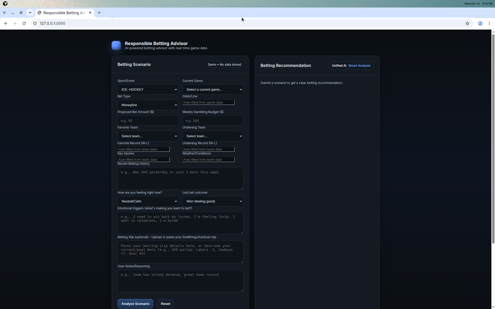
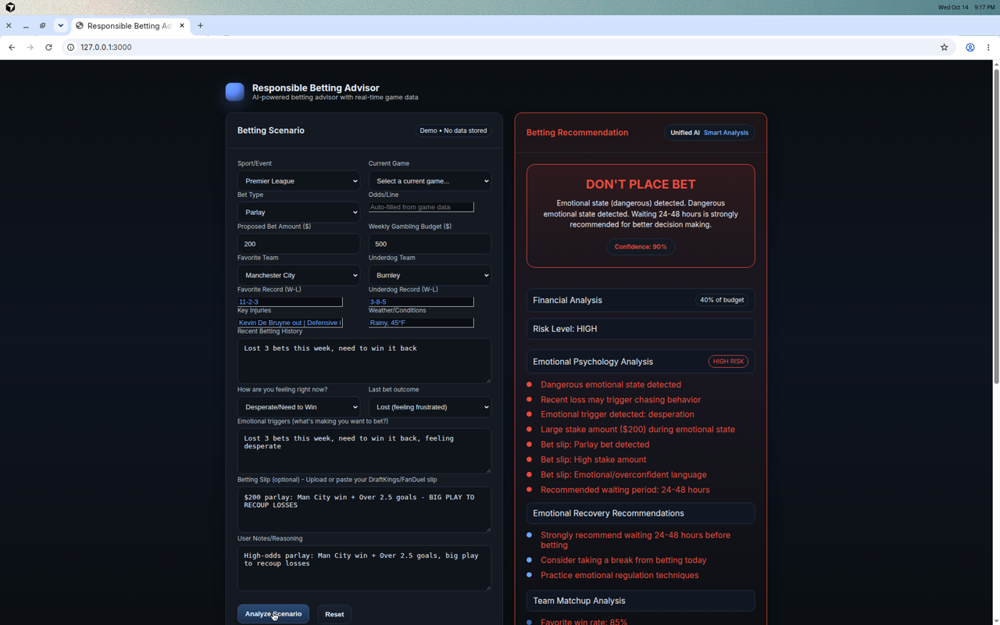
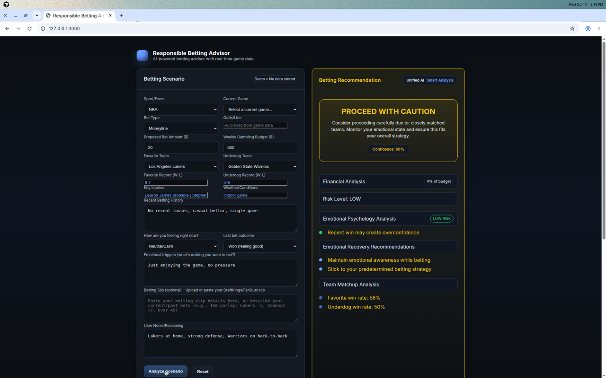

# Serenity Pocket AI

Responsible Betting Advisor is a hackathon demo from Serenity Pocket. A person describes a bet and how they feel. The page then runs two in-browser agents and a combined recommendation that can say **PLACE BET**, **DON'T PLACE BET**, or **PROCEED WITH CAUTION**.

Serenity Pocket is no longer live. The work later evolved into PlayMind Labs. This repository is a public portfolio archive for Shay Bouchles.

The app does not place bets, hold money, or store what you type. The form is marked **Demo • No data stored**.

## What it does

Everything below is what `hackathon/index.html` actually does.

You enter:

- A sport, grouped by league: NFL; NBA and NCAA Basketball; MLB and NCAA Baseball; NHL and ICE_HOCKEY; Premier League, La Liga, MLS, and Champions League; ATP, WTA, and Grand Slam; MMA/UFC, Boxing, Golf, and Other
- A current game, a bet type (Moneyline, Spread, Over/Under, or Parlay), a stake, and a weekly gambling budget
- Favorite and underdog, with read-only record, injury, and weather fields
- Recent betting history, current emotion, last outcome, emotional triggers, an optional pasted betting slip, and notes

Three buttons load a low-risk, moderate-risk, or high-risk scenario.

**Analyze Scenario** runs three functions in the page:

1. **Analytical agent** (`analyticalAgent`). Qualitative notes on bet type, stake as a percent of the weekly budget, and parlays, plus a fixed checklist: injuries, recent form, home and away, line movement, and weather. It does not calculate a numeric expected value.
2. **Safety agent** (`harmAgent`, via `detectSignals`). Keyword and threshold rules. It flags a stake above 15% of budget, chasing language, high frequency, emotional language, and a parlay after losses. The safety card is **LOW**, **MODERATE**, or **HIGH**.
3. **Unified recommendation** (`unifiedRecommendationAgent`). Emotion is applied first. A high emotional-risk state returns **DON'T PLACE BET**, with a suggested wait (24–48 hours when the emotional risk is high, 2–4 hours when it is moderate). Other inputs can return **PLACE BET** or **PROCEED WITH CAUTION**, a confidence score, recovery suggestions, and a win rate parsed from the W-L record. `emotionalPsychologyAnalysis` and `parseBettingSlip` feed that decision.

`agentFetch` sends the analytical and safety results through `fetch` of local blob URLs so the two assessments resolve together. The page does not call OpenAI, Anthropic, or any other model API.

**Games.** On load, and whenever the sport changes, the page requests `https://sportsbook-api2.p.rapidapi.com/v0/advantages/?type=ARBITRAGE`. The key shipped in the file is the placeholder `RAPIDAPI_KEY_PLACEHOLDER`. If that request fails, `getMockGames` fills the dropdown from fixtures embedded in the page. Records, injuries, and weather come from `mockSportsData` in the same file. A `Set` drops duplicate games.

A local run on 14 October 2026, served at `http://127.0.0.1:3000`, showed:

- The sport defaults to ICE_HOCKEY. The game list contains Utah Mammoth @ New York Rangers and Washington Capitals @ Tampa Bay Lightning from the embedded fixtures. The team menus list the six hockey clubs in `mockSportsData`.
- **Load HIGH RISK example**, then analyze: **DON'T PLACE BET**, confidence 90%, safety risk HIGH. The Premier League parlay scenario (Manchester City vs Burnley, $200 of a $500 budget, emotion Desperate/Need to Win) is what the page filled in.
- **Load LOW RISK example**, then analyze: **PROCEED WITH CAUTION**, confidence 60%, safety risk LOW. The embedded Lakers (9-7) and Warriors (8-8) records are close, about 56% and 50%. **PLACE BET** requires a wider favorite gap and no injury, weather, parlay, size, or emotional flag, so this example stays on caution.

`hackathon/README.md` is the original hackathon write-up. Where it disagrees with this file, this file follows the code.

## Responsible gambling

This demo is informational. It is not financial, legal, or clinical advice, and a ruleset on a web page cannot make a wager safe.

If gambling is hurting you or someone you know, stop and use a local help line. In the United States, the National Problem Gambling Helpline is **1-800-GAMBLER** (call or text).

## Stack

| Piece | What the repo uses |
| --- | --- |
| Interface | One HTML file, embedded CSS, vanilla JavaScript. No framework and no bundler. |
| Sports data | Optional RapidAPI host `sportsbook-api2.p.rapidapi.com`. The checked-in key is a placeholder, so a normal run uses the embedded fixtures. |
| Database | A Supabase Postgres migration only. Tables: `user_profiles`, `betting_analyses`, `user_settings`, with row level security. The page never opens a Supabase client. |
| Hosting notes | `hackathon/vercel.json` rewrites every path to `index.html`. `hackathon/supabase/deploy.toml` describes a static deploy. There is no `supabase/functions` directory. |
| Local server | Node (`npm start`). `hackathon/local_server.ps1` is the original Windows server. |

## Architecture

```text
hackathon/index.html
        |
        +-- getCurrentGames()
        |     GET sportsbook-api2 /v0/advantages/?type=ARBITRAGE
        |     fallback: getMockGames()
        |
        +-- mockSportsData
        |     records, injuries, weather
        |
        +-- agentFetch()  (local blob URLs, Promise.all)
              |-- analyticalAgent()
              |-- harmAgent() -> detectSignals()
              |
              +-- unifiedRecommendationAgent()
                    emotionalPsychologyAnalysis()
                    parseBettingSlip()
                    PLACE BET | DON'T PLACE BET | PROCEED WITH CAUTION
```

The only network call in the advisor is that optional sports request. Analysis stays in the browser.

## Repository layout

- `hackathon/index.html` — the advisor
- `hackathon/test_sports_system.js` — Node smoke script with a mocked `fetch`
- `hackathon/test_suite.html`, `comprehensive_test.html`, `sports_dropdown_test.html` — browser test pages
- `hackathon/supabase/` — CLI config and `migrations/20241122000000_initial_schema.sql`
- `hackathon/local_server.ps1` — Windows static server
- `hackathon/README.md`, `VERSION.txt`, `DEPLOYMENT_GUIDE.md` — original hackathon notes (version 1.1.0, dated 2024-11-22 in `VERSION.txt`)
- `scripts/serve.js`, `scripts/build.js` — local server and static build
- `.env.example` and `hackathon/.env.example` — the same variable names, no values

## Setup

Node.js 18 or newer.

```bash
npm install
npm test
npm run build
npm start
```

Open http://127.0.0.1:3000.

`npm test` runs `hackathon/test_sports_system.js`. The script mocks the sports response and prints one line per sport. A sport that falls back to fixture data still finishes with exit code 0.

`npm run build` checks that `hackathon/index.html` still contains the advisor title and the three agent functions, then copies `index.html` and `vercel.json` to `dist/`. `dist/` is gitignored.

The advisor runs with no `.env` file. For the optional names used by the deploy notes and the Node server:

```bash
cp .env.example .env
```

Put values only in `.env`, and do not commit that file. The names are:

| Name | Where it is referenced |
| --- | --- |
| `RAPIDAPI_KEY` | `hackathon/test_sports_system.js` reads `process.env.RAPIDAPI_KEY`. The HTML file uses a placeholder constant instead. |
| `RAPIDAPI_HOST` | Documented next to the sports client. The HTML file hardcodes `sportsbook-api2.p.rapidapi.com`. |
| `SUPABASE_URL`, `SUPABASE_ANON_KEY`, `SUPABASE_SERVICE_ROLE_KEY` | Named in `hackathon/DEPLOYMENT_GUIDE.md` and `hackathon/supabase/deploy.toml` (the service role key is in the guide). The page does not read them. Keep a service role key on a server. |
| `NODE_ENV` | Named in `hackathon/supabase/deploy.toml`. |
| `PORT` | `scripts/serve.js` listens on `PORT` or 3000. |

From `hackathon/` on Windows, `powershell -ExecutionPolicy Bypass -File local_server.ps1` serves the same folder.

## Screenshots

Taken from a local `npm start` on 14 October 2026.







## Contributors

Git history has one commit, `hackathon ai` (23 November 2025):

- Shay Bouchles (`shaythegay13`)

## License

This repository has no license file.
